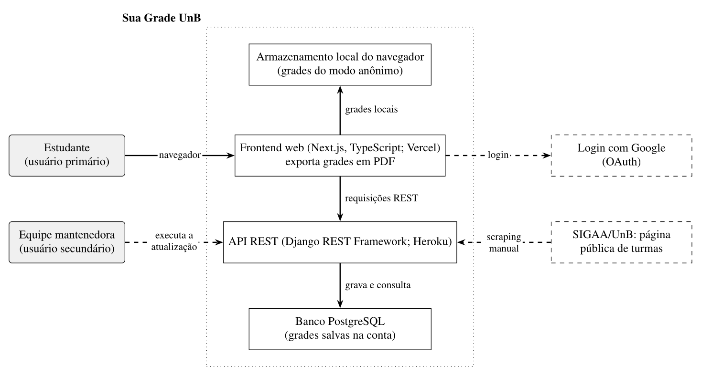
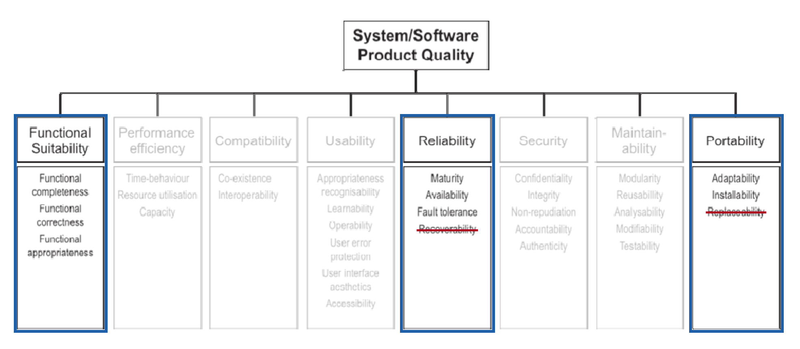

# Sua Grade UnB — Grupo Hedy Lamarr

## Introdução

Somos o grupo **Hedy Lamarr**, da disciplina **Qualidade de Software** da Universidade de Brasília (UnB), ministrada pela professora Cristiane Soares Ramos. Neste repositório, reunimos os documentos e as evidências produzidos durante a avaliação do [Sua Grade UnB](https://suagradeunb.com.br/).

Este repositório é dedicado ao trabalho acadêmico da disciplina; ele não contém o código-fonte oficial do Sua Grade UnB.

## Sobre o produto

O [Sua Grade UnB](https://suagradeunb.com.br/) é uma aplicação web que ajuda estudantes da Universidade de Brasília a organizar as disciplinas e os horários do semestre em uma grade.

## Documentos da Fase 1

| Documento | Conteúdo |
|---|---|
| [Propósito da avaliação](docs/fase-1/proposito.md) | Objetivos e motivação da avaliação. |
| [Requisitantes e partes interessadas](docs/fase-1/requisitantes.md) | Pessoas e grupos envolvidos ou interessados no produto. |
| [Descrição do produto](docs/fase-1/produto.md) | Contexto e características do Sua Grade UnB. |
| [Justificativas](docs/fase-1/justificativas.md) | Motivos das escolhas feitas para a avaliação. |
| [Modelo de qualidade e escopo](docs/fase-1/modelo.md) | Modelo adotado, características selecionadas e limites da avaliação. |
| [Tabela de contribuição](docs/fase-1/contribuicao.md) | Participação dos integrantes nas atividades. |

## Materiais complementares

| Material | Para que serve |
|---|---|
| [Heatmap de disponibilidade](docs/extras/heatmap.md) | Consulta dos horários indicados para reuniões. |
| [Modelo de ata](docs/atas/padrao-ata.md) | Registro de participantes, decisões e encaminhamentos das reuniões. |
| [Relatório de revisão da Fase 1](docs/RELATORIO_REVISAO_FASE1.md) | Registro das correções e dos pontos que ainda precisam ser conferidos. |

## Diagramas e evidências

Os diagramas e as imagens usados no trabalho estão na pasta [`docs/assets/`](docs/assets/). Os principais estão disponíveis aqui para facilitar a consulta.

### Contexto do produto

### Fluxo de uso

### Modelo de qualidade

A imagem original do modelo está em [`modelo-qualidade-iso-original.png`](docs/assets/modelo-qualidade-iso-original.png). O heatmap pode ser consultado em [`heatmap.png`](docs/assets/heatmap.png), com a explicação em [Heatmap de disponibilidade](docs/extras/heatmap.md).

## Colaboradores

**Tabela 1** - Colaboradores.

|  |  |  |  |  |
| :-------------------------------------------------------: | :-------------------------------------------------------: | :----------------------------------------------------------: | :-------------------------------------------------------------: | :------------------------------------------------------------: |
|      [João Vitor Santos](https://github.com/Jauzimm)      |       [Caua Clemente](https://github.com/CauaoClemente)        |      [Pablo Rodrigues](https://github.com/Pablo-R-L)      |       [Leonardo Rodrigues](https://github.com/LeonardoRodriguesMarrtinns99)       |       [Joao Victor](https://github.com/jmarquees)
