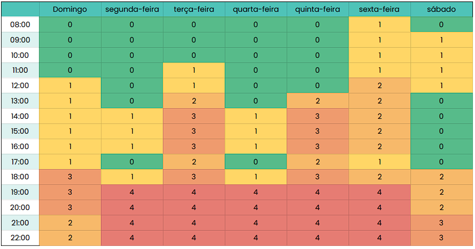

# HeatMap

## Introdução

No projeto, optou-se pela utilização de um heatmap como uma ferramenta visual eficaz para ilustrar a disponibilidade coletiva dos participantes durante a semana. Essa abordagem permite uma análise detalhada e intuitiva da disponibilidade de cada membro, facilitando o planejamento de eventos em grupo ao consolidar as informações de todos os envolvidos em uma única representação gráfica.

## Objetivos

Este heatmap foi desenvolvido com o objetivo de mapear a disponibilidade de horário entre os membros do grupo, visando encontrar um horário livre comum para reuniões e desenvolvimento do projeto.

## Metodologia

O processo de realização do heatmap teve seu início com a coleta de dados de disponibilidade dos membros do grupo, organizados em uma planilha. Com base no agrupamento desses dados, identificou-se o melhor horário para a realização das reuniões do grupo.

**Figura 1** - Heatmap de disponibilidade dos integrantes.

**Link para o Heatmap:** [Clique aqui para acessar o Heatmap](https://docs.google.com/spreadsheets/d/1XmlP6x-2t0WNYGtiMJDihgd2RSVSFR6L7yZ9iDQOjkc/edit?usp=sharing)

Autor(es):  [João Vitor](https://github.com/Jauzimm), 2026.

## Disponibilidade

De acordo com o heatmap, a equipe tem a possibilidade de realizar reuniões nos seguintes horários:

| Segunda-feira | Terça-feira | Quarta-feira | Quinta-feira | Sexta-feira |
| --- | --- | --- | --- | --- |
| 19:00 | 19:00 | 19:00 | 19:00 | 19:00 |
| 20:00 | 20:00 | 20:00 | 20:00 | 20:00 |
| 21:00 | 21:00 | 21:00 | 21:00 | 21:00 |
| 22:00 | 22:00 | 22:00 | 22:00 | 22:00 |

## **Histórico de Versões**

| Versão |          Descrição          |                       Autor                       |    Data    |                       Revisor                       | Data de revisão |
| :----: | :-------------------------: | :-----------------------------------------------: | :--------: | :-------------------------------------------------: | :-------------: |
|  1.0   |       Versão Inicial        |     [João Vitor](https://github.com/Jauzimm)      | 18/10/2026 | [Leonardo Rodrigues](https://github.com/Antedeguemon21) |   |
