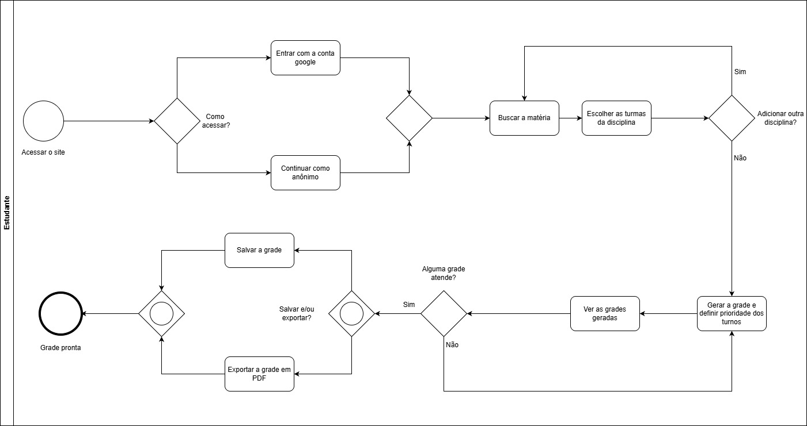

# 2.3 Descrição do Produto

O objetivo desta página é fornecer uma visão geral do software em avaliação, com seu tipo, suas funções, seus componentes e os fatos que sustentam a descrição.

---

## Informações Básicas

- **Nome do produto**: Sua Grade UnB
- **Versão avaliada**: estado em produção em 17/10/2026. O produto não exibe número de versão.
- **Aplicação do produto**: aplicação web de planejamento acadêmico, que ajuda estudantes a montar suas grades horárias
- **Classificação do produto**: COTS (*commercial off-the-shelf*), segundo a IEEE 1062: todos os usuários usam o mesmo produto, sem personalização por cliente. É distribuído como software livre.
- **Origem**: projeto da disciplina Métodos de Desenvolvimento de Software (MDS), da UnB
- **Repositório do código principal**: [GitHub: unb-mds/2023-2-SuaGradeUnB](https://github.com/unb-mds/2023-2-SuaGradeUnB)
- **Licença do produto**: MIT License
- **Linguagens de implementação**: TypeScript (frontend) e Python (backend)
- **Site oficial**: <https://suagradeunb.com.br>
- **API**: <https://api.suagradeunb.com.br>
- **Documentação**: [Arquitetura](https://unb-mds.github.io/2023-2-SuaGradeUnB/architecture/)
- **Último commit no repositório**: 15/02/2026

---

## 2.3.1 Sobre o Sua Grade UnB

### O que é?

O **Sua Grade UnB** ajuda estudantes da UnB a montar suas grades horárias de forma fácil e intuitiva. O estudante busca disciplinas por matéria ou professor, escolhe as turmas, e o sistema gera combinações de grade sem conflitos de horário. As grades podem ser salvas e exportadas em PDF.

### Arquitetura técnica

O produto é formado por duas aplicações:

- O **frontend** (`suagradeunb.com.br`), em TypeScript, Next.js e Tailwind CSS, hospedado na Vercel.
- O **backend**, uma API REST (`api.suagradeunb.com.br`), em Python, Django e Django REST Framework, com banco PostgreSQL, hospedado no Heroku.

Os dados de turmas vêm de *web scraping* da página pública de turmas do SIGAA e ficam no banco. Segundo a documentação, a atualização é manual, feita pela equipe de desenvolvimento, que tenta rodá-la a cada 24 h.

A geração de grades usa produto cartesiano (`itertools.product`), com filtro de conflitos e de disciplinas repetidas. A API retorna as cinco melhores grades.

Figura 1: Contexto do Sua Grade UnB. Linhas tracejadas indicam fontes e ações externas ao produto.

Autor(es):  [João Vitor](https://github.com/Jauzimm), 2026.

---

## 2.3.2 Sobre o uso do Sua Grade UnB

- **Funções do produto**: login com Google; acesso anônimo; busca por matéria ou professor; consulta de turmas; geração de grades com prioridade de turno; salvamento; exportação em PDF
- **Público-alvo**: estudantes da UnB, com uso básico de navegador
- **Dispositivos e conectividade**: basta um navegador com internet.
- **Modos de uso**: anônimo (as grades ficam no navegador) e com login Google (as grades ficam salvas na conta e acessíveis de outro dispositivo)
- **Suporte**: repositório do GitHub, na aba "Sobre" no site, com instruções de uso e como contribuir.

### Fluxos da navegação mapeada

Tabela 1: O mapeamento do site

| # | Fluxo | Rota ou gatilho | O que faz |
| :---: | :--- | :--- | :--- |
| 1 | Acesso inicial | `/` | Apresenta o serviço; login com Google (OAuth) ou "Continuar como anônimo" |
| 2 | Painel de montagem | `/schedules/home` | Mostra as matérias adicionadas, permite remover turmas e gerar a grade |
| 3 | Busca e seleção de disciplinas | Modal "Buscar matéria" | Filtra por ano e período; busca por matéria ou professor; mostra código da turma, horários, sala e docente |
| 4 | Adição de várias disciplinas | Painel | Reúne várias disciplinas no painel antes de gerar |
| 5 | Geração e preferência de turnos | Modal de "Gerar Grade" | Define a prioridade dos turnos manhã, tarde e noite e resolve conflitos |
| 6 | Suas Grades | `/schedules/mygrades` | Lista as grades salvas; abrir, exportar e excluir |
| 7 | Grade semanal detalhada | Modal ao clicar na grade | Matriz de segunda a sábado, das 08:00 às 22:30, com salas e professores |
| 8 | Sobre | Ícone de informações (`/schedules/info`) | Propósito, instruções de uso, como contribuir e colaboradores |

Autor(es):  [João Vitor](https://github.com/Jauzimm), 2026.

Figura 2: Fluxo BPMN de criação de grade

Autor(es):  [João Vitor](https://github.com/Jauzimm), 2026.

### Descrição estruturada

Tabela 2: Resumo técnico e funcional

| Item | Descrição |
| :--- | :--- |
| Funções (11) | 1. Login com Google; 2. Criar grade horária; 3. Filtrar matérias; Selecionar turma; 4. Adicionar matéria selecionada; 5. Selecionar preferencia de turno; 6. Fazer registro e login via google; 7. Visualizar grade horária; 8. Salvar grade localmente; 9. Apagar grade local; 10. Salvar grade na nuvem; 11. Acesso anônimo |
| Janelas e tarefa principal | Sete janelas: boas-vindas, painel de montagem, busca, prioridade de turno, Suas Grades, grade semanal e Sobre. Tarefa principal: montar, com as turmas escolhidas, uma grade sem conflitos, e salvá-la ou exportá-la |
| Componentes | Frontend (Next.js, TypeScript; Vercel); API REST (Django REST Framework; Heroku); banco PostgreSQL |
| Interfaces e dependências | Login com Google (OAuth); página pública de turmas do SIGAA, lida por *web scraping* que, segundo a documentação, a equipe executa manualmente e tenta repetir a cada 24 h; armazenamento local do navegador no modo anônimo |
| Restrições | Até quatro turmas por disciplina; prioridade Mínima, Média ou Máxima para os turnos manhã, tarde e noite; até 10 grades salvas na conta; grade semanal de segunda a sábado, das 08:00 às 22:30; a API retorna as cinco melhores grades |
| Usuários, dados e ambiente | Estudantes da UnB, com uso básico de navegador. A oferta de turmas pública no SIGAA serve de massa de dados para comparação |

Autor(es):  [João Vitor](https://github.com/Jauzimm), [Pablo Rodrigues](https://github.com/Pablo-R-L), 2026.

### O que a avaliação consegue medir

Como a avaliação é externa, é possível medir:

1. A presença e a operação das funções nos oito fluxos, nos modos anônimo e logado;
2. A correção dos dados de turmas frente ao SIGAA;
3. A ausência de conflitos nas grades geradas;
4. A disponibilidade, por sondagem periódica;
5. A comportamento em diferentes navegadores, sistemas e telas;
6. A reação a entradas inválidas.

---

## 2.3.3 ODS, metas e indicadores

**ODS 4: Educação de Qualidade**

O projeto se relaciona ao ODS 4, em especial à **meta 4.3**. Na versão adaptada ao Brasil, publicada pelo IPEA, a meta é: "Até 2030, assegurar a equidade (gênero, raça, renda, território e outros) de acesso e permanência à educação profissional e à educação superior de qualidade, de forma gratuita ou a preços acessíveis".

O indicador oficial dessa meta, o **4.3.1** (taxa de participação de jovens e adultos na educação formal e não formal nos últimos 12 meses, por sexo), tem escala populacional e não pode ser alterado por um software isolado. Por isso o usamos como contexto, não como medida do produto.

**Justificativa.** A pertinência está na permanência dos estudantes. Planejar o semestre é uma etapa recorrente da vida acadêmica em uma universidade pública, e o Sua Grade UnB reduz o esforço dessa etapa. Argumentamos que a qualidade do produto determina se esse apoio é confiável: dados corretos (Adequação Funcional), disponibilidade quando o estudante precisa (Confiabilidade) e acesso nos dispositivos que ele usa (Portabilidade). A avaliação contribui, portanto, de forma indireta para o ODS 4, ao apontar melhorias que sustentam essa confiança.

---

## Bibliografia

> 1. EQUIPE SUA GRADE UNB. *Sua Grade UnB: repositório do projeto no GitHub*. Disponível em: <https://github.com/unb-mds/2023-2-SuaGradeUnB>. Acesso em: 17 out. 2026.

> 2. EQUIPE SUA GRADE UNB. *Arquitetura*. In: Docs - Sua Grade UnB. Disponível em: <https://unb-mds.github.io/2023-2-SuaGradeUnB/architecture/>. Acesso em: 17 out. 2026.

> 3. IEEE. *IEEE Std 1062-1998: Recommended Practice for Software Acquisition*. 1998 apud RAMOS, Cristiane Soares. *Processo de Avaliação de Produto de Software*. Material da disciplina Qualidade de Software 1. Universidade de Brasília (UnB), 2026.

> 4. INSTITUTO DE PESQUISA ECONÔMICA APLICADA. *ODS 4: Educação de Qualidade*. Disponível em: <https://ipea.gov.br/ods/ods4.html>. Acesso em: 18 out. 2026.

## Histórico de Versão

| Versão |          Descrição          |                       Autor                       |    Data    |                       Revisor                       | Data de revisão |
| :----: | :-------------------------: | :-----------------------------------------------: | :--------: | :-------------------------------------------------: | :-------------: |
|  1.0   |       Versão Inicial        |     [João Vitor](https://github.com/Jauzimm)      | 18/10/2026 | [Caua Clemente](https://github.com/CauaoClemente) |   |
|  1.1   |       Padronização das funções do sistema        |     [Pablo Rodrigues](https://github.com/Pablo-R-L)      | 21/10/2026 |  |   |

