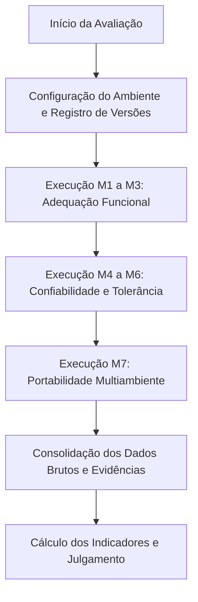

# 3.1 Plano de Avaliação de Produto

## 1. Introdução

Este documento constitui o Plano de Avaliação de Produto do Sua Grade UnB, elaborado na Fase 3 do processo de avaliação de qualidade de software, em conformidade com as diretrizes da norma ISO/IEC 25040 (Processo de Avaliação da família SQuaRE).

O propósito deste plano é estabelecer com precisão o método de avaliação, as instruções executáveis para os avaliadores, os requisitos de ambiente, a massa de dados de teste padronizada, o cronograma operacional e a rastreabilidade direta com os objetivos e métricas definidos na Fase 2 (GQM). O rigor no detalhamento deste artefato visa assegurar a repetibilidade (capacidade de o mesmo avaliador obter o mesmo resultado em condições idênticas) e a reprodutibilidade (capacidade de avaliadores distintos obterem os mesmos resultados seguindo as mesmas instruções).

---

## 2. Método de Avaliação e Instruções Detalhadas (Roteiro do Avaliador)

A avaliação adota o método de inspeção e teste de caixa-preta da aplicação em ambiente de produção acessível ao público (https://suagradeunb.com.br/). O avaliador interage exclusivamente pela interface de usuário (UI) nos navegadores homologados, sem interferência em código ou banco de dados.

Abaixo estão detalhados os procedimentos operacionais padronizados (POP) para a execução de cada uma das sete métricas especificadas na Fase 2.

### 2.1. Procedimento para M1 - Completude Funcional

* **Métrica associada:** M1: `C_f = (F_i / F_p) * 100`
  * `C_f`: completude funcional, em porcentagem;
  * `F_i`: número de funcionalidades planejadas que estão implementadas;
  * `F_p`: número total de funcionalidades planejadas (total: 11).
* **Objetivo:** Verificar a disponibilidade prática das funcionalidades previstas no [story map](https://miro.com/app/board/uXjVNYnku7s=/?share_link_id=596015837126).
* **Instruções passo a passo:**
  1. Acessar a aplicação no endereço oficial utilizando o navegador de referência (Google Chrome em modo padrão, sem extensões de bloqueio de script).
  2. Para cada funcionalidade listada no [story map](https://miro.com/app/board/uXjVNYnku7s=/?share_link_id=596015837126) do projeto, verificar se os elementos visuais de controle (botões, campos, menus suspensos) estão presentes na interface.
  3. Executar o acionamento direto do elemento e checar se o sistema executa a ação correspondente:
     * R1 (Criar grade): Iniciar com grade vazia e verificar a renderização do grid semanal.
     * R2 (Filtrar matéria): Digitar o código da disciplina na barra de busca e checar se a lista filtra em tempo real.
     * R3 (Selecionar turma): Clicar sobre a disciplina filtrada e selecionar uma turma específica.
     * R4 (Adicionar matéria): Clicar no botão de inclusão e verificar se a matéria é alocada no grid.
     * R5 (Preferência de turno): Testar os filtros de turno matutino, vespertino ou noturno.
     * R6 (Login via Google): Acionar o botão "Entrar com Google" e validar o redirecionamento OAuth.
     * R7 (Visualizar grade): Observar a disposição visual das células com horários e salas.
     * R8 (Salvar localmente): Clicar na opção de persistência local / download de grade.
     * R9 (Apagar grade local): Tentar encontrar e executar a exclusão de uma grade salva localmente.
     * R10 (Salvar na nuvem): Com usuário autenticado, salvar a grade no perfil remoto.
     * R11 (Apagar grade na nuvem): Com usuário autenticado, excluir a grade remota da lista.
  4. Para cada requisito, registrar no formulário de coleta: Status (Implementado ou Não Implementado), Data/Hora e link da captura de tela (evidência).

### 2.2. Procedimento para M2 - Correção Funcional

* **Métrica associada:** M2: `C_c = (A_c / A_v) * 100`
  * `C_c`: proporção de atributos acadêmicos corretos, em porcentagem;
  * `A_c`: número de atributos verificados que correspondem aos dados do SIGAA;
  * `A_v`: número total de atributos verificados (total: 15 atributos, sendo 3 para cada uma das 5 disciplinas).
* **Objetivo:** Comparar os dados acadêmicos exibidos pelo Sua Grade UnB com os dados oficiais do SIGAA/UnB.
* **Instruções passo a passo:**
  1. Acessar simultaneamente duas abas no navegador:
     * Aba A: Sua Grade UnB (https://suagradeunb.com.br/);
     * Aba B: SIGAA UnB - Consulta Pública de Turmas (https://sigaa.unb.br/).
  2. Consultar as cinco disciplinas definidas na Massa de Dados Oficial (Seção 4 deste plano).
  3. Para cada disciplina e turma especificada, coletar e comparar lado a lado 3 atributos:
     * Atributo 1 - Nome do Docente: Confrontar o docente cadastrado no Sua Grade com o docente principal no SIGAA.
     * Atributo 2 - Local / Sala: Verificar se o pavilhão e sala (ex.: "I3", "S6") coincidem.
     * Atributo 3 - Horário Oficial: Verificar a codificação do horário (ex.: "35M12", "24M34").
  4. Caso o dado seja estritamente coincidente, registrar como Correto. Caso haja divergência ou campo em branco no produto avaliado, registrar como Incorreto.
  5. Salvar captura de tela com as duas janelas visíveis como evidência comprobatória.

### 2.3. Procedimento para M3 - Adequação às Tarefas dos Usuários

* **Métrica associada:** M3: `A_f = (T_a / T_p) * 100`
  * `A_f`: adequação funcional às tarefas avaliadas, em porcentagem;
  * `T_a`: número de tarefas consideradas adequadamente atendidas;
  * `T_p`: número total de tarefas avaliadas (total: 5 tarefas).
* **Objetivo:** Avaliar se as tarefas-chave do fluxo do estudante são atendidas de ponta a ponta.
* **Instruções passo a passo:**
  1. O avaliador deve desempenhar o papel de estudante universitário no período de matrícula.
  2. Executar em sequência as cinco tarefas padronizadas:
     * Tarefa T1 (Autenticação): Fazer login com conta institucional Google (@aluno.unb.br). Critério de sucesso: perfil logado exibido no topo.
     * Tarefa T2 (Pesquisa de disciplinas): Buscar disciplinas por nome ou código sem erros de busca.
     * Tarefa T3 (Composição de grade): Montar uma grade de 20 a 24 créditos sem choques de horário.
     * Tarefa T4 (Geração visual e exportação): Visualizar o quadro completo de horários e exportar em imagem ou salvar.
     * Tarefa T5 (Gestão de persistência): Desconectar, reconectar e recuperar a grade previamente salva.
  3. Cada tarefa é julgada como Atendida se permitiu atingir o objetivo sem bloqueios de interface.

### 2.4. Procedimento para M4 - Maturidade (Confiabilidade)

* **Métrica associada:** M4: `M_c = (C_s / C_t) * 100`
  * `M_c`: proporção de cenários de confiabilidade concluídos sem falhas, em porcentagem;
  * `C_s`: número de cenários concluídos sem falhas observáveis;
  * `C_t`: número total de cenários de confiabilidade avaliados (total: 4 cenários).
* **Objetivo:** Avaliar a ausência de travamentos e falhas operacionais sob uso contínuo e repetido.
* **Instruções passo a passo:**
  1. Cenário de Repetição: Realizar 10 buscas e seleções sucessivas de disciplinas na mesma sessão sem recarregar o navegador. Observar se ocorre lentidão progressiva ou falhas de renderização.
  2. Cenário de Persistência: Montar uma grade com 4 disciplinas. Pressionar F5 (recarregar página). Observar se as disciplinas selecionadas são restauradas ou se a grade é zerada.
  3. Cenário de Uso Contínuo: Manter a aplicação aberta em segundo plano por 30 minutos com grade montada; após o período, tentar adicionar uma nova disciplina e validar a resposta do sistema.
  4. Cenário de Múltiplas Sessões: Efetuar logout da conta Google, fechar o navegador, reabrir em modo anônimo, logar novamente e verificar se os dados remotos foram mantidos íntegros.
  5. Registrar qualquer exceção no console do navegador (tecla F12 -> Console) ou falha visual.

### 2.5. Procedimento para M5 - Disponibilidade Observada

* **Métrica associada:** M5: `D = (V_s / V_t) * 100`
  * `D`: disponibilidade observada nas verificações, em porcentagem;
  * `V_s`: número de verificações bem-sucedidas;
  * `V_t`: número total de verificações realizadas (total: 15 verificações ao longo de 5 dias).
* **Objetivo:** Medir a taxa de sucesso no acesso ao serviço durante uma janela temporal de 5 dias corridos.
* **Instruções passo a passo:**
  1. Definir 3 janelas diárias de verificação:
     * Manhã: entre 09:00 e 10:30;
     * Tarde: entre 14:00 e 15:30;
     * Noite: entre 20:00 e 21:30.
  2. No instante da verificação:
     * Acessar a URL raiz https://suagradeunb.com.br/.
     * Aguardar o carregamento da tela inicial (limite aceitável: até 5 segundos).
     * Executar uma busca simples pela disciplina "Cálculo 1".
  3. Se a página carregar com código HTTP 200 e a busca retornar turmas, marcar como Ativo (Sucesso).
  4. Caso ocorra erro HTTP (ex.: 502, 503, 504, 404), travamento de tela ou timeout, registrar como Inativo (Falha).
  5. Tirar print com o relógio do sistema operacional visível e catalogar na planilha de medição.

### 2.6. Procedimento para M6 - Tolerância a Falhas

* **Métrica associada:** M6: `T_f = (F_i / F_t) * 100`
  * `T_f`: proporção de situações de falha tratadas adequadamente, em porcentagem;
  * `F_i`: número de situações de falha identificadas e comunicadas adequadamente pelo sistema;
  * `F_t`: número total de situações de falha avaliadas (total: 5 testes).
* **Objetivo:** Avaliar se o sistema identifica condições anômalas ou inválidas e emite alertas compreensíveis ao usuário.
* **Instruções passo a passo:**
  1. Teste T1 (Busca sem período letivo): Limpar o filtro de semestre letivo e tentar submeter a consulta de disciplinas. Verificar se o sistema impede a busca vazia e orienta o usuário.
  2. Teste T2 (Seleção excessiva de turmas): Tentar marcar mais de quatro turmas da mesma disciplina simultaneamente. Verificar se o sistema limita a seleção ou exibe aviso explicativo.
  3. Teste T3 (Busca com termo inexistente): Inserir texto sem correspondência (ex.: "XZY9999_INEXISTENTE") no campo de busca. Verificar se a interface apresenta mensagem de "Nenhuma matéria encontrada" em vez de tela em branco ou erro de script.
  4. Teste T4 (Injeção de choque de horário): Selecionar intencionalmente duas turmas que compartilhem o mesmo dia e bloco de horário (ex.: Terça 10h-12h). Tentar alocar ambas na mesma grade e verificar se o sistema emite alerta explícito de conflito de horários.
  5. Teste T5 (Submissão sem parâmetros): Clicar no botão de filtrar sem digitar texto ou selecionar categoria. Verificar o feedback visual emitido pelo sistema.
  6. Para cada teste, registrar se o aviso foi claro, instrutivo e preveniu a inconsistência.

### 2.7. Procedimento para M7 - Adaptabilidade em Ambientes Avaliados (Portabilidade)

* **Métrica associada:** M7: `A_p = (A_c / A_t) * 100`
  * `A_p`: proporção de ambientes compatíveis, em porcentagem;
  * `A_c`: número de ambientes em que o produto atende às condições definidas;
  * `A_t`: número total de ambientes avaliados (total: 6 ambientes).
* **Objetivo:** Avaliar a operacionalidade do sistema em múltiplos navegadores e fatores de forma (Desktop e Mobile).
* **Instruções passo a passo:**
  1. Acessar o sistema nos 6 ambientes homologados:
     * Ambiente 1 (Desktop): Mozilla Firefox (Windows 11)
     * Ambiente 2 (Desktop): Opera GX (Windows 11)
     * Ambiente 3 (Desktop): Brave Browser (Windows 11)
     * Ambiente 4 (Desktop): Microsoft Edge (Windows 11)
     * Ambiente 5 (Mobile): Google Chrome (Android 14)
     * Ambiente 6 (Mobile): DuckDuckGo Privacy Browser (Android 14)
  2. Em cada ambiente, executar o fluxo básico:
     * Carregamento da página inicial;
     * Renderização responsiva do grid de horários sem quebras ou sobreposições de texto;
     * Busca de disciplina e adição de turma ao quadro;
     * Abertura do menu de configurações/salvamento.
  3. Classificar cada ambiente como Compatível (sem falhas impeditivas de layout ou script) ou Incompatível.

---

## 3. Especificação dos Recursos e do Ambiente de Avaliação

Para garantir que a avaliação seja rigorosa e reprodutível por auditores externos ou membros da equipe docente, os recursos técnicos foram padronizados:

### 3.1. Requisitos de Hardware

| Componente | Ambiente Desktop (Estação do Avaliador) | Ambiente Mobile (Dispositivo Móvel) |
| :--- | :--- | :--- |
| **Equipamento** | Notebook / Desktop PC | Smartphone |
| **Processador** | 4 núcleos (mínimo 2.0 GHz) | Octa-Core (ARM) |
| **Memória RAM** | Mínimo 8 GB | Mínimo 4 GB |
| **Resolução de Tela** | 1920 x 1080 pixels (Full HD) | 2400 x 1080 pixels (proporção 20:9) |
| **Conexão de Rede** | Banda larga fixa (mínimo 50 Mbps) | Rede sem fio Wi-Fi 5 GHz / 4G LTE estável |

### 3.2. Requisitos de Software

* **Sistemas Operacionais:**
  * Windows 11 Pro / Home (versão 23H2 ou superior);
  * Android 14 (OneUI / Pixel UI).
* **Navegadores Homologados:**
  * Google Chrome Desktop: Versão 129.0 ou superior;
  * Mozilla Firefox Desktop: Versão 131.0 ou superior;
  * Microsoft Edge Desktop: Versão 129.0 ou superior;
  * Brave Browser Desktop: Versão 1.70 ou superior;
  * Opera GX Desktop: Versão 114.0 ou superior;
  * Google Chrome Mobile: Versão 129.0 ou superior;
  * DuckDuckGo Browser Mobile: Versão 5.210 ou superior.
* **Ferramentas de Captura e Registro:**
  * Ferramenta de Captura nativa do Windows (atalho Win + Shift + S) para capturas de tela com carimbo visual;
  * Gravador de tela nativo (Xbox Game Bar no Windows e gravador nativo do Android) em resolução 1080p a 30fps;
  * Planilha eletrônica padronizada para registro de data, hora, código de teste e resultado.

### 3.3. Perfil e Conhecimento Exigido dos Avaliadores

* Conhecimento prévio básico da estrutura acadêmica da Universidade de Brasília (código de turmas, notação de horários como 24M12, 35T34 e divisão departamental).
* Habilidade básica de operação de navegadores web e ferramentas de inspeção do navegador (DevTools para verificação de erros no console).
* Não é exigido conhecimento de linguagens de programação do produto ou acesso privilegiado ao servidor.

---

## 4. Massa de Dados e Dados-Exemplo (SIGAA / UnB)

De acordo com o critério F3-C2, a massa de dados foi formalmente definida para eliminar subjetividades durante a coleta de evidências de adequação funcional, corretude e tolerância a falhas.

As disciplinas e turmas selecionadas pertencem ao catálogo oficial da Faculdade UnB Gama (FGA) e do Instituto de Ciências Exatas (IE) da Universidade de Brasília:

### 4.1. Conjunto Principal de Disciplinas para Verificação de Corretude (M2)

| ID Amostra | Código | Nome da Disciplina | Turma | Docente Oficial (SIGAA) | Local / Sala | Horário Oficial | Evidencias |
| :---: | :---: | :--- | :---: | :--- | :---: | :---: | :---: |
| **D1** | IFD071 | Física 1 | 13 | Lindomar | I3 | 35M12 | [Sala e horario](https://github.com/FCTE-Qualidade-de-Software-1/2026-2_T02_HEDY_LAMAR/blob/reorganizacao/docs/evidencias/sigaa/fisica%201.png), [Professor e código](https://github.com/FCTE-Qualidade-de-Software-1/2026-2_T02_HEDY_LAMAR/blob/reorganizacao/docs/evidencias/sigaa/prf%20Fisica.png) |
| **D2** | FGA0060 | Banco de Dados 2 | 01 | Vandor | I10 | 35T34 | [Sala e horario](https://github.com/FCTE-Qualidade-de-Software-1/2026-2_T02_HEDY_LAMAR/blob/reorganizacao/docs/evidencias/sigaa/Arquitetura%20e%20desenho.png), [Professor e código](https://github.com/FCTE-Qualidade-de-Software-1/2026-2_T02_HEDY_LAMAR/blob/reorganizacao/docs/evidencias/sigaa/prf%20Arqitetura.png) | 
| **D3** | FGA0315 | Qualidade de Software 1 | 01 | Cristiane Ramos | S6 | 24M34 | [Sala e horario](https://github.com/FCTE-Qualidade-de-Software-1/2026-2_T02_HEDY_LAMAR/blob/reorganizacao/docs/evidencias/sigaa/Qualidade%20de%20software.png), [Professor e código](https://github.com/FCTE-Qualidade-de-Software-1/2026-2_T02_HEDY_LAMAR/blob/reorganizacao/docs/evidencias/sigaa/prf%20Qualidade.png) |
| **D4** | FGA0208 | Arquitetura e Desenho de Software | 01 | Milene | S4 | 26M12 | [Sala e horario](https://github.com/FCTE-Qualidade-de-Software-1/2026-2_T02_HEDY_LAMAR/blob/reorganizacao/docs/evidencias/sigaa/Arquitetura%20e%20desenho.png), [Professor e código](https://github.com/FCTE-Qualidade-de-Software-1/2026-2_T02_HEDY_LAMAR/blob/reorganizacao/docs/evidencias/sigaa/prf%20Arqitetura.png) |
| **D5** | FGA0254 | Ciências Aeroespaciais | 01 | Gabriela | S5 | 35M34 | [Sala e horario](https://github.com/FCTE-Qualidade-de-Software-1/2026-2_T02_HEDY_LAMAR/blob/reorganizacao/docs/evidencias/sigaa/Ciencias%20aeroespaciasi.png), [Professor e código](https://github.com/FCTE-Qualidade-de-Software-1/2026-2_T02_HEDY_LAMAR/blob/reorganizacao/docs/evidencias/sigaa/prf%20Ciencias.png) |

### 4.2. Massa de Dados para Testes de Conflito de Horário (Tolerância a Falhas - M6)

Para a execução controlada da métrica de tolerância a falhas e verificação do algoritmo de choque de horários, os pares abaixo devem ser utilizados:

| Caso de Teste | Disciplina A (Turma) | Horário A | Disciplina B (Turma Conflitante) | Horário B | Conflito Esperado |
| :---: | :--- | :---: | :--- | :---: | :--- |
| **C1** | Física 1 (T01) | 35M12 (Ter/Qui 08h-10h) | Cálculo 1 (T02) | 35M12 (Ter/Qui 08h-10h) | **Sim (Conflito direto)** |
| **C2** | Qualidade de Software (T01) | 24M34 (Seg/Qua 10h-12h) | Banco de Dados 1 (T01) | 24M34 (Seg/Qua 10h-12h) | **Sim (Conflito direto)** |
| **C3** | Arq. e Desenho de Software (T01) | 26M12 (Seg/Sex 08h-10h) | Banco de Dados 2 (T01) | 35T34 (Ter/Qui 16h-18h) | **Não (Horários distintos)** |

---

## 5. Cronograma Executivo de Coleta e Avaliação

A tabela a seguir consolida a distribuição temporal das atividades, indicando as métricas associadas, fontes de dados, responsáveis e entregáveis produzidos:

Tabela 1: Cronograma executivo de avaliação

| Etapa / Atividade | Métricas Envolvidas | Período de Execução | Fonte de Dados / Ambiente | Entregável / Evidência |
| :--- | :--- | :--- | :--- | :--- |
| **E1.1** Consulta dos requisitos no *Story Map* | M1 | 18/10/2026 | Board no GitHub do Sua Grade UnB | Lista de 11 funcionalidades planejadas ([2.1 em plano-de-avaliacao](https://github.com/FCTE-Qualidade-de-Software-1/2026-2_T02_HEDY_LAMAR/blob/main/docs/fase-3/plano-avaliacao.md)) |
| **E1.2** Seleção da Amostra Acadêmica no SIGAA | M2 | 23/10/2026 | SIGAA UnB (Turmas 2026/2) | Tabela de 5 disciplinas e 15 atributos de referência ([Seção 4.1 em plano-avaliacao](https://github.com/FCTE-Qualidade-de-Software-1/2026-2_T02_HEDY_LAMAR/blob/main/docs/fase-3/plano-avaliacao.md)) |
| **E1.3** Especificação dos Cenários de Teste e Ambientes | M3, M4, M6, M7 | 20/10/2026 | Documentação de teste | Matriz de 6 ambientes e 4 cenários de confiabilidade ([Seção 2.7, 3.2 e 3.1  em plano-avaliacao](https://github.com/FCTE-Qualidade-de-Software-1/2026-2_T02_HEDY_LAMAR/blob/main/docs/fase-3/plano-avaliacao.md)) |
| **E2.1** Verificação Contínua de Disponibilidade (Dia 1 ao Dia 5) | M5 | 19/10/2026 a 23/10/2026 | Produção (Manhã, Tarde e Noite) | 15 capturas de tela rotuladas (E1 a E15) ([M5  em metricas](https://github.com/FCTE-Qualidade-de-Software-1/2026-2_T02_HEDY_LAMAR/blob/reorganizacao/docs/fase-4/Metricas.md)) |
| **E2.2** Execução dos Testes de Completude e Adequação às Tarefas | M1, M3 | 20/10/2026 | Interface Web do produto | Matriz de 10/11 requisitos e 5/5 tarefas atendidas ([M1 e M3  em metricas](https://github.com/FCTE-Qualidade-de-Software-1/2026-2_T02_HEDY_LAMAR/blob/reorganizacao/docs/fase-4/Metricas.md)) |
| **E2.3** Inspeção de Correção Funcional (Comparativo SIGAA) | M2 | 23/10/2026 | Sua Grade UnB vs. SIGAA | Tabela comparativa de 15 atributos e 5 evidências visualizadas [M2 em metricas](https://github.com/FCTE-Qualidade-de-Software-1/2026-2_T02_HEDY_LAMAR/blob/reorganizacao/docs/fase-4/Metricas.md) |
| **E2.4** Execução dos Cenários de Confiabilidade e Tolerância a Falhas | M4, M6 | 20/10/2026 a 21/10/2026 | Interface Web e tratamentos de erro | Registros de 4 cenários de maturidade e 5 testes de avisos ([M4 e M6  em metricas](https://github.com/FCTE-Qualidade-de-Software-1/2026-2_T02_HEDY_LAMAR/blob/reorganizacao/docs/fase-4/Metricas.md)) |
| **E2.5** Testes de Adaptabilidade em Multiambientes | M7 | 22/10/2026 | 4 Navegadores PC + 2 Mobile | 6 capturas de tela comprovando execução em Windows e Android ([M7 em metricas](https://github.com/FCTE-Qualidade-de-Software-1/2026-2_T02_HEDY_LAMAR/blob/reorganizacao/docs/fase-4/Metricas.md)) |
| **E3.1** Consolidação dos Dados e Cálculos de Porcentagem | M1 a M7 | 22/10/2026 a 24/10/2026 | `Metricas.md` | Resultados percentuais ($90,91\%$ a $100\%$) ([metricas](https://github.com/FCTE-Qualidade-de-Software-1/2026-2_T02_HEDY_LAMAR/blob/reorganizacao/docs/fase-4/Metricas.md)) |
| **E3.2** Enquadramento e Julgamento de Qualidade | M1 a M7 | 22/10/2026 a 24/10/2026 | `criterios.md` | Julgamento final (Nível *Excelente* para todas as métricas) ([criterios](https://github.com/FCTE-Qualidade-de-Software-1/2026-2_T02_HEDY_LAMAR/blob/reorganizacao/docs/fase-4/criterios.md)) |
| **E4.1** Elaboração e Execução da Ação de Melhoria | Ação Técnica F4-C5 | 13/11/2026 a 16/11/2026 | Repositório do Projeto / Protótipo | Relatório de justificativa e artefato de melhoria incorporado |

---

## 6. Matriz de Rastreabilidade e Coerência entre Fases 2 e 3

Para atender ao critério F3-C8 em nível Excelente, a tabela abaixo demonstra que todas as métricas, níveis de pontuação e critérios de julgamento estabelecidos na Fase 2 possuem métodos e recursos estritamente coerentes e justificados neste plano:

| Métrica Fase 2 | Subcaracterística | Método no Plano (Fase 3) | Recursos e Massa Aplicada | Critério de Julgamento da Fase 2 |
| :---: | :--- | :--- | :--- | :--- |
| **M1** | Completude Funcional | Inspeção visual direta de 11 requisitos no ambiente de produção. | Navegador Google Chrome Desktop; checklist do Story Map. | Excelente: >= 90% (pelo menos 10 de 11 funções ativas). |
| **M2** | Correção Funcional | Auditoria cruzada entre a interface do Sua Grade e a consulta pública do SIGAA. | 5 disciplinas padronizadas (15 atributos: docente, sala e horário). | Excelente: >= 95% (15 de 15 atributos coincidentes). |
| **M3** | Adequação Funcional | Execução simulada de 5 tarefas principais do estudante universitário. | Fluxo ponta a ponta: busca, montagem, exportação e salvamento. | Excelente: 100% das tarefas executáveis sem erro impeditivo. |
| **M4** | Maturidade | Execução de 4 cenários de teste contínuo, repetição e persistência. | Sessão contínua de 30 min, 10 repetições de busca, testes de refresh. | Excelente: 100% dos cenários concluídos sem falhas observáveis. |
| **M5** | Disponibilidade | Verificação por amostragem em 15 janelas temporais ao longo de 5 dias. | Amostragem matutina, vespertina e noturna via requisições web. | Excelente: 100% das verificações com carregamento bem-sucedido. |
| **M6** | Tolerância a Falhas | Injeção deliberada de 5 situações anômalas (choque de horários e buscas nulas). | Pares de turmas conflitantes (Massa C1, C2) e strings inválidas. | Excelente: 100% das falhas comunicadas com aviso claro ao usuário. |
| **M7** | Portabilidade (Adaptabilidade) | Teste de renderização e usabilidade em 6 ambientes distintos. | 4 navegadores desktop (Windows 11) e 2 navegadores mobile (Android 14). | Excelente: 100% de conformidade nos ambientes homologados. |

---

## 7. Histórico de Versão

| Versão | Descrição | Autor | Data | Revisor | Data de revisão |
| :----: | :-----------------------------------------------------------: | :-----------------------------------------------: | :--------: | :-------------------------------------------------: | :-------------: |
| 1.0 | Criação inicial do Plano de Avaliação (Fase 3), detalhamento de métodos, instruções dos avaliadores, ambiente, massa de dados e rastreabilidade com a Fase 2 | [Cauã Clemente](https://github.com/CauaoClemente) | 06/11/2026 | [Pablo Rodrigues](https://github.com/Pablo-R-L) | 12/11/2026 |
| 1.1 | Adaptação da tabela de cronograma e adição do link do story map e evidencia das materias usadas na metrica M2 | [Pablo Rodrigues](https://github.com/Pablo-R-L) | 13/11/2026 | | |

