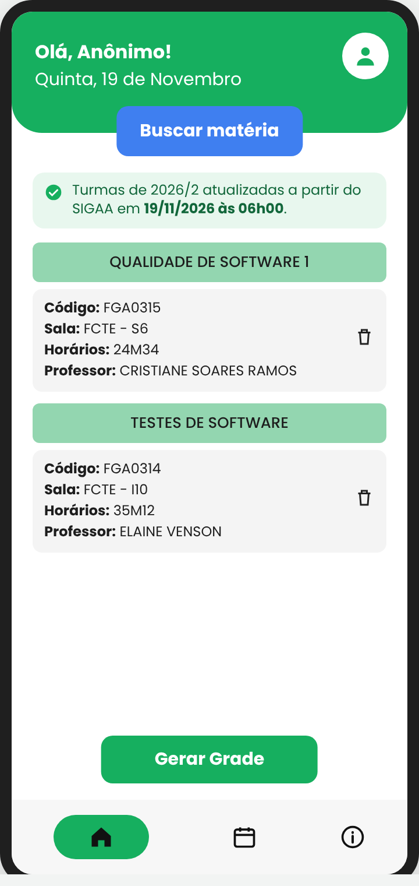
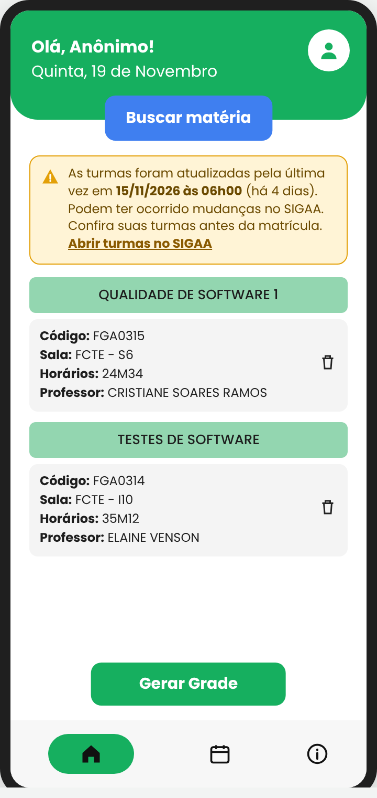
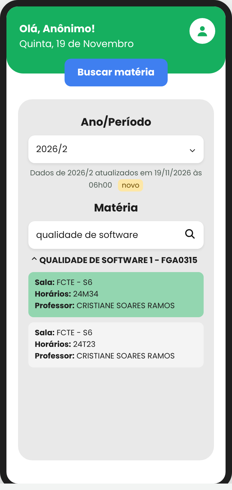

# Ação de melhoria

## 1. Introdução

Esta página apresenta a ação de melhoria executada na Fase 4: um **protótipo de alta fidelidade** da indicação da data da última atualização dos dados do SIGAA no Sua Grade UnB. A ação corresponde à oportunidade selecionada em [Oportunidades de melhoria](oportunidades-de-melhoria.md) (seção 2.1).

Como o código-fonte oficial do Sua Grade UnB não é mantido neste repositório, a ação é apresentada como entrega técnica: as telas propostas, o comportamento esperado, o caminho de implementação e os critérios de aceitação para a equipe mantenedora.

## 2. Problema tratado

Hoje, o estudante não tem como saber, pelo produto, quando as turmas exibidas foram atualizadas a partir do SIGAA. A justificativa completa está na seção 2.1 de [Oportunidades de melhoria](oportunidades-de-melhoria.md). Em resumo:

- a Decisão 2 do [propósito da avaliação](../fase-1/proposito.md) (automatizar ou monitorar a atualização manual dos dados) ficou sem apoio dos resultados, conforme o [Julgamento final](julgamento-final.md);
- o próprio produto documenta que a atualização é manual e já corrigiu uma falha na coleta do SIGAA;
- a M2 só garante a correção dos dados na data da coleta;
- uma falha na atualização não é registrada nem comunicada ao usuário, que continua vendo os dados anteriores.

A ação é **preventiva e de monitoramento**: a avaliação não mediu dados desatualizados.

## 3. Protótipo

O protótipo reproduz a interface atual do Sua Grade UnB, observada na coleta complementar de 18 e 19/11/2026, e acrescenta apenas os elementos marcados como "novo". A versão completa, com as anotações, pode ser aberta em [protótipo interativo (HTML)](prototipo/prototipo-data-atualizacao.html).

Tabela 1: Telas do protótipo

| Tela 1 — Dados atualizados | Tela 2 — Dados possivelmente defasados | Tela 3 — Busca de matéria |
| :---: | :---: | :---: |
|  |  |  |

Fonte: protótipo elaborado pela equipe. Os nomes, as turmas e os horários são ilustrativos.

- **Tela 1:** um selo abaixo do botão "Buscar matéria" informa o período letivo e a data e a hora da última atualização bem-sucedida.
- **Tela 2:** quando a última atualização ultrapassa o limite definido pela equipe mantenedora (48 horas no exemplo), o selo vira um alerta com a data, há quanto tempo ocorreu e um link para a consulta pública de turmas do SIGAA.
- **Tela 3:** na busca, a data de atualização aparece logo abaixo da escolha do período letivo, no momento em que o estudante escolhe as turmas.

Autor(es): [Cauã Clemente](https://github.com/CauaoClemente), 2026.

## 4. Como implementar no produto

1. **Registrar a data:** ao final de cada execução bem-sucedida do [comando de atualização do banco](https://github.com/unb-mds/2023-2-SuaGradeUnB/blob/main/api/api/management/commands/updatedb.py), gravar a data e a hora da atualização de cada período letivo. Hoje o produto não guarda essa informação.
2. **Expor a data:** devolver esse registro junto com os dados de turmas consultados pela interface.
3. **Exibir na interface:** mostrar o selo da Tela 1 e a data da Tela 3, e exibir o alerta da Tela 2 quando a última atualização ultrapassar o limite definido.

## 5. Critérios de aceitação

Tabela 2: Critérios de aceitação propostos à equipe mantenedora

| Nº | Critério |
| :---: | :--- |
| CA1 | A data exibida corresponde à última execução bem-sucedida da atualização do período letivo selecionado. |
| CA2 | Uma atualização que falha não altera a data exibida. |
| CA3 | O alerta aparece somente quando a última atualização ultrapassa o limite definido pela equipe mantenedora. |
| CA4 | O link do alerta abre a consulta pública de turmas do SIGAA. |
| CA5 | A indicação aparece na tela inicial e na busca de matéria, para usuários anônimos e com login. |

Fonte: elaborado pela equipe.

## 6. Limitações

- O protótipo não foi implementado no produto; ele é uma proposta para a equipe mantenedora.
- O limite de 48 horas é um exemplo; o valor adequado depende da frequência de atualização que a equipe mantenedora conseguir manter.
- O protótipo não foi avaliado com usuários.

---

## Bibliografia

> 1. UNB-MDS. *Sua Grade UnB*: código-fonte. GitHub, 2023-2026. Disponível em: <https://github.com/unb-mds/2023-2-SuaGradeUnB>.

## Histórico de Versão

| Versão | Descrição | Autor | Data | Revisor | Data de revisão |
| :----: | :--- | :--- | :---: | :--- | :---: |
| 1.0 | Protótipo de alta fidelidade da indicação da data de atualização dos dados | [Cauã Clemente](https://github.com/CauaoClemente) | 19/11/2026 | | |
