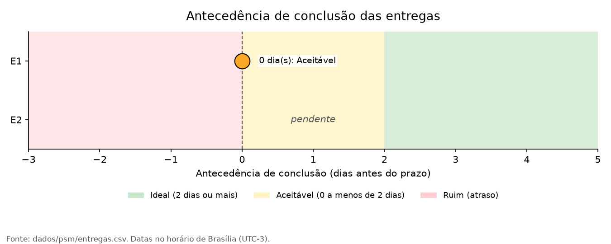
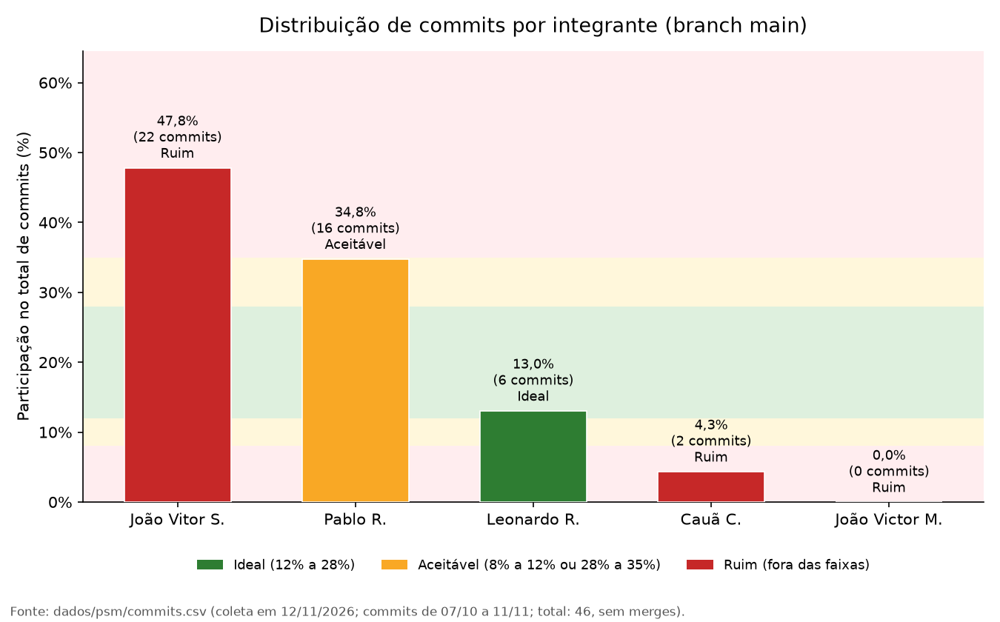
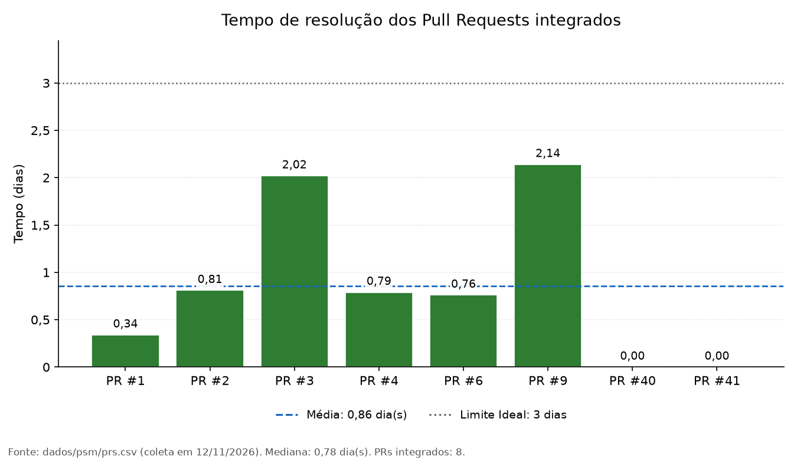

# Plano de Medição e Acompanhamento (PSM/CID)

## 1. Objetivo

Este documento reúne as métricas utilizadas para acompanhar o
desenvolvimento do projeto, com foco no cumprimento dos prazos, na
distribuição das contribuições registradas no repositório e no tempo
necessário para integrar Pull Requests à branch `main`.

A coleta e a consolidação dos dados usam arquivos versionados em
`dados/psm/` e scripts em `scripts/`, que consultam o histórico e os
registros do GitHub. Os resultados são atualizados a cada coleta,
mantendo a rastreabilidade entre os indicadores apresentados e os dados
de origem. As medições, suas interpretações e as decisões de gestão
decorrentes estão registradas nas seções 3 a 6.

## 2. Escopo e coleta dos dados

As métricas deste documento são:

-   **Antecedência de conclusão:** verifica se as entregas foram
    concluídas antes do prazo combinado.
-   **Distribuição de esforço por commits:** apresenta como os commits
    estão distribuídos entre os integrantes da equipe.
-   **Tempo médio de resolução de Pull Requests:** mede quanto tempo os
    Pull Requests permanecem abertos até serem integrados à branch
    `main`.

Cada métrica está associada a uma das categorias do modelo PSM/CID
exigidas para o acompanhamento do projeto:

| Categoria PSM/CID | Métrica | Justificativa |
|---|---|---|
| Calendário e Progresso | Métrica 1: Antecedência de conclusão | Compara a data combinada com a data efetiva de conclusão de cada entrega. |
| Recursos e Custos | Métrica 2: Distribuição de esforço por commits | Os commits são o indicador disponível do esforço da equipe, que é o principal recurso do projeto. |
| Desempenho dos Processos | Métrica 3: Tempo médio de resolução de Pull Requests | Mede a rapidez com que o fluxo de revisão e integração do repositório conclui as alterações. |

Os dados de cada métrica ficam em `dados/psm/` e os gráficos são
gerados por scripts em `scripts/` a partir desses arquivos. Os
resultados numéricos e os gráficos de cada métrica estão nas seções 3 a
5.

> **Nota sobre interpretação:** a quantidade de commits é utilizada como
> um indicador indireto da distribuição das contribuições registradas.
> Embora ela seja uma boa aproximação do esforço geral dos integrantes,
> ela não representa, isoladamente, a complexidade ou a
> qualidade do trabalho de cada integrante e não considera o trabalho no LaTeX.

------------------------------------------------------------------------

## 3. Métrica 1 - Antecedência de conclusão

**Categoria PSM/CID:** Calendário e Progresso.

### 3.1. Objetivo

Avaliar se as entregas do projeto foram concluídas antes dos prazos
previamente combinados pela equipe.

### 3.2. Definição

A métrica considera a diferença entre a data combinada para a conclusão
de uma entrega e a data em que ela foi efetivamente concluída.

Um resultado positivo indica que a entrega foi concluída antes do prazo;
um resultado igual a zero indica conclusão no prazo; e um resultado
negativo indica atraso.

| Classificação | Critério (antecedência em dias) |
|---|---|
| Ideal | 2 dias ou mais |
| Aceitável | De 0 (no prazo) até menos de 2 dias |
| Ruim | Menor que 0 (entrega com atraso) |

A antecedência é medida em dias corridos entre datas de calendário, e as
datas são consideradas no horário de Brasília (UTC−3), fuso em que os
prazos da disciplina são definidos.

### 3.3. Forma de cálculo

Para cada entrega:

**Antecedência (em dias) = data do prazo combinado − data de conclusão**

Também é calculada a proporção de entregas concluídas
antecipadamente:

**Percentual de entregas antecipadas = (quantidade de entregas
concluídas antes do prazo / quantidade total de entregas avaliadas) ×
100**

### 3.4. Fonte dos dados e coleta

-   **Fonte do prazo:** especificação do trabalho final da disciplina
    (Entrega 1: 26/10/2026; a data da Entrega 2 segue o cronograma da
    disciplina).
-   **Fonte da conclusão:** data e hora de publicação da Release da
    entrega no GitHub (Release v1.0.0, "Entrega 1"), que é o produto de
    trabalho exigido para cada entrega.
-   **Registro:** os prazos e as conclusões estão em
    [`dados/psm/entregas.csv`](https://github.com/FCTE-Qualidade-de-Software-1/2026-2_T02_HEDY_LAMAR/blob/main/dados/psm/entregas.csv).
    O script `scripts/gerar_grafico_entregas.py` calcula a antecedência
    e gera a Figura 1. A cada nova entrega, basta incluir o prazo e a
    data de publicação da Release no arquivo.

### 3.5. Resultado

-   Quantidade de entregas avaliadas: 1 (Entrega 1; a Entrega 2 está
    pendente)
-   Quantidade de entregas concluídas antes do prazo: 0
-   Quantidade de entregas concluídas no prazo: 1
-   Quantidade de entregas concluídas após o prazo: 0
-   Percentual de entregas antecipadas: 0%
-   Antecedência média das entregas concluídas antes do prazo: não se
    aplica (nenhuma entrega antecipada)

Entrega 1: prazo em 26/10/2026; Release v1.0.0 publicada em 26/10/2026,
às 21:55 (horário de Brasília). Antecedência = 26/10 − 26/10 = 0 dia
(classificação: **Aceitável**).

### 3.6. Visualização dos resultados

*Figura 1: Antecedência de conclusão das entregas (dias antes do prazo).
Fonte: `dados/psm/entregas.csv`, gerado por
`scripts/gerar_grafico_entregas.py`.*

### 3.7. Análise

A Entrega 1 foi concluída no próprio dia do prazo, o que a coloca na
faixa Aceitável, mas sem margem de segurança: qualquer imprevisto no
mesmo dia teria resultado em atraso. A Release foi publicada às 21:55,
com poucas horas de folga antes do fim do dia. Também por isso a
conversão para o horário de Brasília é necessária, pois a mesma
publicação aparece com data de 27/10 em UTC.

Com apenas uma entrega concluída, a métrica não permite identificar
tendência. O horário limite de entrega no Moodle não está registrado
neste documento, e a data de conclusão considera a publicação da
Release; a data de envio no Moodle poderá ser acrescentada se o grupo
quiser usá-la como referência.

**Decisão de gestão decorrente:** como a Entrega 1 ficou fora da faixa
Ideal, a equipe define para a Entrega 2 um prazo interno 2 dias antes do
prazo oficial, para buscar a faixa Ideal, e acompanha as tarefas
pendentes para redistribuí-las caso o prazo interno esteja em risco.

------------------------------------------------------------------------

## 4. Métrica 2 - Distribuição de esforço por commits

**Categoria PSM/CID:** Recursos e Custos.

### 4.1. Objetivo

Observar como as contribuições registradas por meio de commits estão
distribuídas entre os integrantes da equipe durante o desenvolvimento do
projeto.

### 4.2. Definição

A métrica calcula a participação percentual de cada integrante no total
de commits considerados no período de acompanhamento.

Para evitar atribuições incorretas, a coleta identifica os autores dos
commits e associa seus registros às respectivas pessoas da equipe.
Quando há mais de uma identidade GitHub ou endereço de e-mail associado
à mesma pessoa, essas identidades são consolidadas.

| Classificação | Critério |
|---|---|
| Ideal | 12% a 28% |
| Aceitável | 8% a 12% ou 28% a 35% |
| Ruim | Fora dos critérios |

A classificação é aplicada à participação individual de cada integrante.

### 4.3. Forma de cálculo

**Participação por integrante = (quantidade de commits do integrante /
quantidade total de commits considerados) × 100**

O cálculo deverá considerar o mesmo intervalo de tempo e os mesmos
critérios de inclusão para todos os integrantes.

### 4.4. Fonte dos dados e coleta

-   **Fonte:** histórico de commits da branch `main` do repositório
    GitHub (referência `origin/main`). Os commits coletados estão em
    [`dados/psm/commits.csv`](https://github.com/FCTE-Qualidade-de-Software-1/2026-2_T02_HEDY_LAMAR/blob/main/dados/psm/commits.csv)
    e a relação entre identidades e integrantes está em
    [`dados/psm/integrantes.csv`](https://github.com/FCTE-Qualidade-de-Software-1/2026-2_T02_HEDY_LAMAR/blob/main/dados/psm/integrantes.csv).
-   **Coleta:** o script `scripts/coletar_commits.py` lista os commits
    com `git log`, identifica o autor de cada um e o associa a um
    integrante. O script `scripts/gerar_grafico_commits.py` calcula as
    participações e gera a Figura 2.
-   **Critérios de inclusão:** são considerados os commits da branch
    `main`, de 07/10/2026 (primeiro commit do repositório) até a data da
    coleta. Commits de *merge*, gerados pelo GitHub ao integrar Pull
    Requests e sem alteração autoral, são excluídos. Commits ainda não
    integrados à `main` não são contados.
-   **Tratamento:** cada commit é identificado por seu *hash*, o que
    evita contagem duplicada. As identidades da mesma pessoa foram
    consolidadas em `integrantes.csv`: João Vitor S. (e-mail pessoal e
    e-mail *noreply* do GitHub), Pablo R., Leonardo R. e Cauã C. O
    integrante João Victor M. não possui identidade com commits na
    `main` e é mantido na análise com 0 commits, para que sua
    participação apareça na distribuição.

Um commit pode representar uma alteração
pequena ou extensa; portanto, os percentuais devem ser interpretados
como distribuição das contribuições registradas no Git.

### 4.5. Resultado

-   Período analisado: 07/10/2026 a 11/11/2026 (último commit em
    08/11/2026)
-   Data da coleta: 11/11/2026
-   Total de commits considerados: 40 (sem commits de *merge*)
-   João Vitor S.: 16 commits --- 40,0% (**Ruim**)
-   Pablo R.: 16 commits --- 40,0% (**Ruim**)
-   Leonardo R.: 6 commits --- 15,0% (**Ideal**)
-   Cauã C.: 2 commits --- 5,0% (**Ruim**)
-   João Victor M.: 0 commits --- 0,0% (**Ruim**)

Cálculo da participação (exemplo): 16 / 40 × 100 = 40,0%.

### 4.6. Visualização dos resultados

*Figura 2: Participação de cada integrante no total de commits da
`main` (%). Fonte: `dados/psm/commits.csv`, gerado por
`scripts/coletar_commits.py` e `scripts/gerar_grafico_commits.py`.*

### 4.7. Análise

Dos 40 commits considerados, 80% foram feitos por João Vitor S. e Pablo
R. (16 cada, 40,0%), ambos acima do limite de 35% e, portanto, na faixa
Ruim. Leonardo R. (15,0%) ficou na faixa Ideal, e Cauã C. (5,0%) e João
Victor M. (0,0%) ficaram abaixo de 8%, também na faixa Ruim. Quatro dos
cinco integrantes estão fora das faixas Ideal e Aceitável.

Esse resultado deve ser lido junto com a [Tabela de
contribuição](../fase-1/contribuicao.md), que declara 30% para João
Vitor S., Pablo R. e João Victor M., e 5% para Leonardo R. e Cauã C. A
principal divergência é João Victor M., responsável pela criação e
organização do documento LaTeX: esse trabalho não aparece nos commits
porque o código-fonte do artigo não está versionado no repositório.
Portanto, os 0,0% refletem uma limitação do registro, e não ausência de
esforço. No caso de Cauã C., a participação em commits (5,0%) coincide
com a declarada.

Como a métrica mede apenas commits na `main`, ela não captura o trabalho
realizado fora do Git nem a diferença de tamanho e complexidade entre
os commits, e as faixas de 12% a 28% pressupõem uma divisão próxima de
20% para cada um dos cinco integrantes.

**Decisão de gestão decorrente:** versionar no repositório o
código-fonte LaTeX do artigo, para que esse trabalho passe a ser
registrado e rastreável, e usar a Tabela de contribuição como referência
complementar na interpretação desta métrica. A distribuição será
recalculada na próxima coleta.

------------------------------------------------------------------------

## 5. Métrica 3 - Tempo médio de resolução de Pull Requests

**Categoria PSM/CID:** Desempenho dos Processos.

### 5.1. Objetivo

Mensurar o tempo médio durante o qual um Pull Request permanece aberto,
desde sua criação até sua integração à branch `main`.

### 5.2. Definição

O tempo de resolução corresponde ao intervalo entre a data e hora de
criação de um Pull Request e a data e hora em que ele é integrado
(*merged*) à branch `main`.

Nesta métrica, considera-se como resolução a integração efetiva do Pull
Request à branch `main`, e não apenas seu fechamento. Pull Requests
fechados sem integração não devem ser contabilizados como integrados.

| Classificação | Critério |
|---|---|
| Ideal | Até 3 dias |
| Aceitável | Até 7 dias |
| Ruim | Mais que 7 dias |

A classificação é aplicada ao tempo médio de resolução do período. Os
tempos individuais de cada Pull Request são apresentados na seção 5.6
para permitir a identificação de casos fora do critério.

### 5.3. Forma de cálculo

Para cada Pull Request integrado:

**Tempo de resolução = data e hora da integração − data e hora de
criação**

O tempo médio de resolução será calculado por:

**Tempo médio de resolução = soma dos tempos de resolução dos Pull
Requests integrados / quantidade de Pull Requests integrados**

O resultado será apresentado em dias.

O tempo de resolução é calculado em horas e convertido para dias
dividindo por 24, com o resultado expresso em dias decimais e
arredondado em duas casas.

Como indicador complementar, também é registrada a mediana dos tempos de
resolução, que reduz a influência de valores extremos. A mediana não é
classificada pela tabela de critérios.

### 5.4. Fonte dos dados e coleta

-   **Fonte:** registros de Pull Requests do GitHub, campos de data e
    hora de criação (`createdAt`) e de integração (`mergedAt`), em UTC.
    Os dados coletados estão no arquivo
    [`dados/psm/prs.csv`](https://github.com/FCTE-Qualidade-de-Software-1/2026-2_T02_HEDY_LAMAR/blob/main/dados/psm/prs.csv)
    do repositório.
-   **Coleta:** recuperação, para cada Pull Request, da data e hora de
    criação e da data e hora de integração à branch `main`, com
    registro da data e hora da coleta no próprio arquivo.
-   **Critério de inclusão:** considerar Pull Requests efetivamente
    integrados à branch `main` dentro do período definido para a
    análise. O período analisado vai de 19/10/2026 (criação do primeiro
    Pull Request) até a data da coleta, registrada na seção 5.5.
-   **Tratamento:** Pull Requests fechados sem integração são
    registrados separadamente, mas não incluídos no cálculo do tempo
    médio de integração.
-   **Pull Requests abertos:** Pull Requests ainda abertos na data da
    coleta não são considerados nesta métrica, pois ainda não possuem
    data de integração.

### 5.5. Resultado

-   Período analisado: 19/10/2026 a 11/11/2026
-   Data da coleta: 11/11/2026 (08:03 UTC)
-   Quantidade de Pull Requests integrados considerados: 6
-   Tempo médio de resolução: 1,14 dia (classificação: **Ideal**)
-   Mediana do tempo de resolução: 0,80 dia
-   Menor tempo de resolução observado: 0,34 dia (PR \#1)
-   Maior tempo de resolução observado: 2,14 dias (PR \#9)
-   Pull Requests fechados sem integração: 0

Cálculo do tempo médio: (0,34 + 0,81 + 2,02 + 0,79 + 0,76 + 2,14) / 6 =
6,86 / 6 ≈ 1,14 dia.

Os tempos individuais de cada Pull Request estão na Figura 3 e, com as
datas completas, no arquivo `dados/psm/prs.csv`.

### 5.6. Visualização dos resultados

*Figura 3: Tempo de resolução dos Pull Requests integrados à `main`
(dias). Fonte: `dados/psm/prs.csv`, gerado por
`scripts/gerar_grafico_prs.py`.*

### 5.7. Análise

O tempo médio de resolução foi de 1,14 dia, dentro do critério Ideal
(até 3 dias). Todos os seis Pull Requests integrados levaram menos de
2,2 dias, e a mediana de 0,80 dia, inferior à média, mostra que a
maioria foi integrada em menos de um dia. A média é puxada pelos PRs
\#3 e \#9, que levaram cerca de 2 dias.

O resultado deve ser lido com cautela: a amostra é pequena (seis Pull
Requests) e o tempo de integração depende da disponibilidade dos
integrantes para revisar, não sendo, isoladamente, medida de
produtividade ou de qualidade.

**Decisão de gestão decorrente:** como o resultado está no critério
Ideal, o fluxo atual de integração será mantido, e a métrica será
recalculada na próxima coleta para acompanhar a Entrega 2.

------------------------------------------------------------------------

## 6. Registro de decisões de gestão

Esta seção reúne as decisões tomadas a partir das medições, relacionando
cada uma ao resultado e à interpretação que a motivou, e indicando como
o efeito da decisão será verificado na próxima coleta.

### 6.1. Decisões registradas

Tabela 1: Decisões de gestão decorrentes das medições.

| ID | Categoria PSM/CID | Resultado da medição | Interpretação | Decisão | Verificação na próxima coleta |
|:---:|:---|:---|:---|:---|:---|
| D1 | Calendário e Progresso | Métrica 1: Entrega 1 concluída com 0 dia de antecedência (**Aceitável**), conforme a seção 3.5. | Entrega no próprio dia do prazo, sem margem para imprevistos (seção 3.7). | Definir, para a Entrega 2, um prazo interno 2 dias antes do prazo oficial e acompanhar as tarefas pendentes para redistribuí-las se o prazo interno estiver em risco. | Antecedência da Entrega 2 de 2 dias ou mais (faixa Ideal). |
| D2 | Recursos e Custos | Métrica 2: 40,0% / 40,0% / 15,0% / 5,0% / 0,0% dos 40 commits; quatro de cinco integrantes em **Ruim** (seção 4.5). | A distribuição reflete também o trabalho fora do Git: o código LaTeX do artigo não está versionado no repositório (seção 4.7). | Versionar o código-fonte LaTeX do artigo no repositório e usar a Tabela de contribuição como referência complementar na interpretação da métrica. | Código LaTeX presente no repositório e participação de todos os integrantes registrada nos commits. |
| D3 | Desempenho dos Processos | Métrica 3: tempo médio de resolução de 1,14 dia (**Ideal**), mediana de 0,80 dia, 6 Pull Requests integrados (seção 5.5). | Fluxo de integração rápido; amostra pequena e dependente da disponibilidade para revisão (seção 5.7). | Manter o fluxo atual de integração por Pull Requests. | Tempo médio de resolução de até 3 dias (faixa Ideal) na nova coleta. |

### 6.2. Procedimento de atualização

A cada nova coleta, o grupo deve:

1.  Atualizar os dados em `dados/psm/` (`prs.csv`, `entregas.csv` e, para
    os commits, executar `python scripts/coletar_commits.py` após
    `git fetch origin`).
2.  Gerar os gráficos com os scripts `gerar_grafico_*.py` em `scripts/`.
3.  Atualizar os resultados e a análise nas seções 3 a 5.
4.  Registrar, na Tabela 1, o resultado das decisões anteriores e as
    novas decisões, com a data da coleta.

------------------------------------------------------------------------

## 7. Considerações finais

As três métricas permitem acompanhar dimensões distintas do
desenvolvimento: cumprimento dos prazos combinados, distribuição das
contribuições registradas no Git e tempo de integração das alterações à
branch `main`.

Os resultados deverão ser interpretados considerando o período de
coleta, os critérios de inclusão e as limitações de cada indicador. Em
particular, a quantidade de commits não deve ser tratada como medida
direta de esforço, e o tempo de integração de Pull Requests não deve ser
interpretado isoladamente como medida de produtividade ou qualidade.

## 8. Histórico de atualização  

| Versão | Descrição | Autor | Data | Revisor | Data de revisão |
| :---: | :--- | :--- | :--- | :--- | :--- |
| 1.0 | Criação da documentação das métricas PSM/CID. | [Pablo Rodrigues](https://github.com/Pablo-R-L) | 05/10/2026 | [João Vitor](https://github.com/Jauzimm) | 10/11/2026 |
| 1.1 | Remoção do tópico de evidencias. | [Pablo Rodrigues](https://github.com/Pablo-R-L) | 08/10/2026 | [João Vitor](https://github.com/Jauzimm) | 10/11/2026 |
