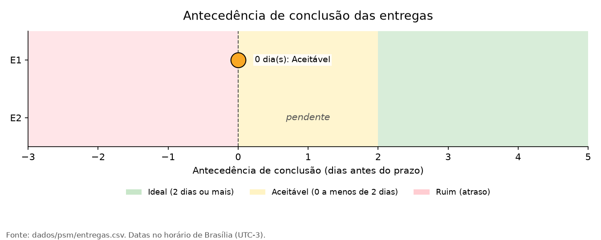

# Métrica 1 - Antecedência de conclusão: resultados e análise

Esta página apresenta o resultado, o gráfico e a análise da Métrica 1. O método está em [Método](metrica-1-metodo.md).

## 3.5. Resultado

-   Quantidade de entregas avaliadas: 1 (Entrega 1; a Entrega 2 está
    pendente)
-   Quantidade de entregas concluídas antes do prazo: 0
-   Quantidade de entregas concluídas no prazo: 1
-   Quantidade de entregas concluídas após o prazo: 0
-   Percentual de entregas antecipadas: 0%
-   Antecedência média das entregas concluídas antes do prazo: não se
    aplica (nenhuma entrega antecipada)

Entrega 1: prazo em 26/10/2026; Release v1.0.0 publicada em 26/10/2026,
às 21:55 (horário de Brasília). Antecedência = 26/10 − 26/10 = 0 dia
(classificação: **Aceitável**).

## 3.6. Visualização dos resultados

*Figura 1: Antecedência de conclusão das entregas (dias antes do prazo).
Fonte: `dados/psm/entregas.csv`, gerado por
`scripts/gerar_grafico_entregas.py`.*

## 3.7. Análise

A Entrega 1 foi concluída no próprio dia do prazo, o que a coloca na
faixa Aceitável, mas sem margem de segurança: qualquer imprevisto no
mesmo dia teria resultado em atraso. A Release foi publicada às 21:55,
com poucas horas de folga antes do fim do dia. Também por isso a
conversão para o horário de Brasília é necessária, pois a mesma
publicação aparece com data de 27/10 em UTC.

Com apenas uma entrega concluída, a métrica não permite identificar
tendência. O horário limite de entrega no Moodle não está registrado
neste plano, e a data de conclusão considera a publicação da
Release; a data de envio no Moodle poderá ser acrescentada se o grupo
quiser usá-la como referência.

!!! success "Decisão de gestão decorrente"
    Como a Entrega 1 ficou fora da faixa
    Ideal, a equipe define para a Entrega 2 um prazo interno 2 dias antes do
    prazo oficial, para buscar a faixa Ideal, e acompanha as tarefas
    pendentes para redistribuí-las caso o prazo interno esteja em risco.
