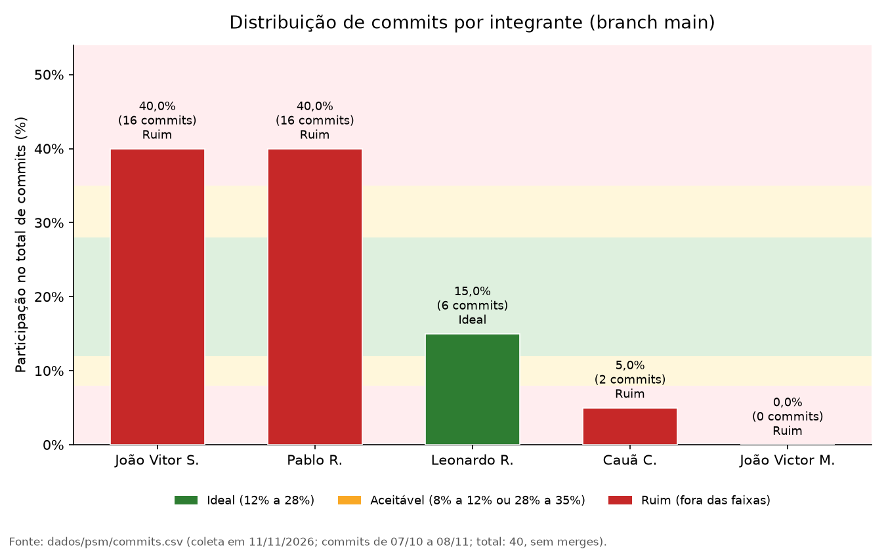

# Métrica 2 - Distribuição de esforço por commits: resultados e análise

Esta página apresenta o resultado, o gráfico e a análise da Métrica 2. O método está em [Método](metrica-2-metodo.md).

## 4.5. Resultado

-   Período analisado: 07/10/2026 a 11/11/2026 (último commit em
    08/11/2026)
-   Data da coleta: 11/11/2026
-   Total de commits considerados: 40 (sem commits de *merge*)
-   João Vitor S.: 16 commits --- 40,0% (**Ruim**)
-   Pablo R.: 16 commits --- 40,0% (**Ruim**)
-   Leonardo R.: 6 commits --- 15,0% (**Ideal**)
-   Cauã C.: 2 commits --- 5,0% (**Ruim**)
-   João Victor M.: 0 commits --- 0,0% (**Ruim**)

Cálculo da participação (exemplo): 16 / 40 × 100 = 40,0%.

## 4.6. Visualização dos resultados

*Figura 2: Participação de cada integrante no total de commits da
`main` (%). Fonte: `dados/psm/commits.csv`, gerado por
`scripts/coletar_commits.py` e `scripts/gerar_grafico_commits.py`.*

## 4.7. Análise

Dos 40 commits considerados, 80% foram feitos por João Vitor S. e Pablo
R. (16 cada, 40,0%), ambos acima do limite de 35% e, portanto, na faixa
Ruim. Leonardo R. (15,0%) ficou na faixa Ideal, e Cauã C. (5,0%) e João
Victor M. (0,0%) ficaram abaixo de 8%, também na faixa Ruim. Quatro dos
cinco integrantes estão fora das faixas Ideal e Aceitável.

Esse resultado deve ser lido junto com a [Tabela de
contribuição](../fase-1/contribuicao.md), que declara 30% para João
Vitor S., Pablo R. e João Victor M., e 5% para Leonardo R. e Cauã C. A
principal divergência é João Victor M., responsável pela criação e
organização do documento LaTeX: esse trabalho não aparece nos commits
porque o código-fonte do artigo não está versionado no repositório.
Portanto, os 0,0% refletem uma limitação do registro, e não ausência de
esforço. No caso de Cauã C., a participação em commits (5,0%) coincide
com a declarada.

Como a métrica mede apenas commits na `main`, ela não captura o trabalho
realizado fora do Git nem a diferença de tamanho e complexidade entre
os commits, e as faixas de 12% a 28% pressupõem uma divisão próxima de
20% para cada um dos cinco integrantes.

!!! success "Decisão de gestão decorrente"
    Versionar no repositório o
    código-fonte LaTeX do artigo, para que esse trabalho passe a ser
    registrado e rastreável, e usar a Tabela de contribuição como referência
    complementar na interpretação desta métrica. A distribuição será
    recalculada na próxima coleta.
