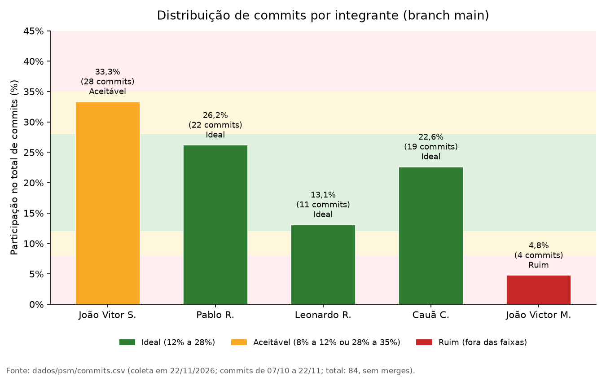

# Métrica 2 - Distribuição de esforço por commits: resultados e análise

Esta página apresenta o resultado, o gráfico e a análise da Métrica 2. O método está em [Método](metrica-2-metodo.md).

## 4.5. Resultado

-   Período analisado: 07/10/2026 a 22/11/2026
-   Data da coleta: 22/11/2026 (11:37 UTC)
-   Total de commits considerados: 84 (sem commits de *merge* e sem os
    commits automáticos do `github-actions[bot]`)
-   João Vitor S.: 28 commits --- 33,3% (**Aceitável**)
-   Pablo R.: 22 commits --- 26,2% (**Ideal**)
-   Cauã C.: 19 commits --- 22,6% (**Ideal**)
-   Leonardo R.: 11 commits --- 13,1% (**Ideal**)
-   João Victor M.: 4 commits --- 4,8% (**Ruim**)

Cálculo da participação (exemplo): 28 / 84 × 100 = 33,3%.

Coleta anterior (11/11/2026, 40 commits): João Vitor S. 40,0% e Pablo
R. 40,0% (**Ruim**), Leonardo R. 15,0% (**Ideal**), Cauã C. 5,0% e
João Victor M. 0,0% (**Ruim**).

## 4.6. Visualização dos resultados

*Figura 2: Participação de cada integrante no total de commits da
`main` (%). Fonte: `dados/psm/commits.csv`, gerado por
`scripts/coletar_commits.py` e `scripts/gerar_grafico_commits.py`.*

## 4.7. Análise

A distribuição melhorou em relação à coleta de 11/11/2026. Naquela
coleta, quatro dos cinco integrantes estavam na faixa Ruim; agora, três
estão na faixa Ideal (Pablo R., Cauã C. e Leonardo R.), um na faixa
Aceitável (João Vitor S., 33,3%, abaixo do limite de 35%) e apenas um
na faixa Ruim (João Victor M., 4,8%). A maior mudança foi a de Cauã C.,
que passou de 2 para 19 commits com a elaboração das páginas da Fase 4
e da ação de melhoria. O total de commits também mais que dobrou (de 40
para 84), o que torna a distribuição mais representativa.

O resultado deve ser lido junto com a [Tabela de
contribuição](../fase-1/contribuicao.md), que declara 20% para cada
integrante na Entrega 2. Os commits de Pablo R., Cauã C. e João Vitor
S. estão próximos do declarado. João Victor M. continua com
participação baixa nos commits porque seu trabalho principal, a
elaboração do artigo em LaTeX, é feito fora do repositório: a decisão
D2, de versionar o código-fonte LaTeX, não foi implementada até esta
coleta. Os 4,8%, portanto, refletem uma limitação do registro, e não
ausência de esforço. Leonardo R. (13,1%) ficou próximo do limite
inferior da faixa Ideal.

Como a métrica mede apenas commits na `main`, ela não captura o trabalho
realizado fora do Git nem a diferença de tamanho e complexidade entre
os commits, e as faixas de 12% a 28% pressupõem uma divisão próxima de
20% para cada um dos cinco integrantes.

!!! success "Decisão de gestão decorrente"
    A distribuição atingiu a faixa Ideal para três integrantes, e a
    equipe mantém a divisão de tarefas adotada na Entrega 2. Como a
    decisão D2 não foi implementada, o trabalho no LaTeX continua fora
    dos commits; por isso, a participação de João Victor M. deve ser
    interpretada com base na Tabela de contribuição, e o versionamento
    do código-fonte LaTeX fica registrado como recomendação para
    projetos futuros.