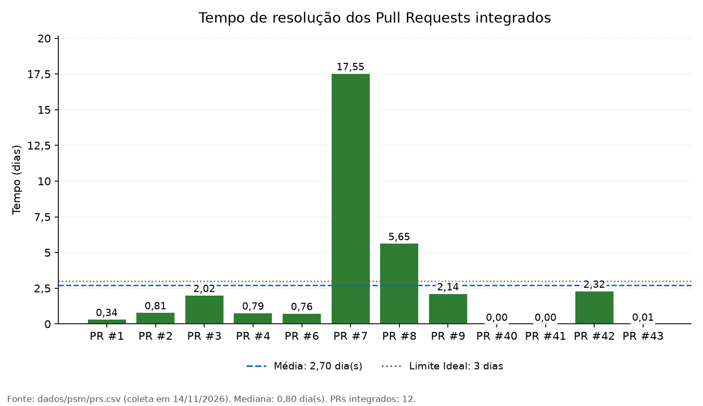

# Métrica 3 - Tempo médio de resolução de Pull Requests: resultados e análise

Esta página apresenta o resultado, o gráfico e a análise da Métrica 3. O método está em [Método](metrica-3-metodo.md).

## 5.5. Resultado

- Período analisado: 19/10/2026 a 22/11/2026.
- Data da coleta registrada: 22/11/2026 (11:37 UTC).
- Quantidade de Pull Requests integrados considerados: 31.
- Tempo médio de resolução: 1,21 dia (classificação: **Ideal**).
- Mediana do tempo de resolução: 0,16 dia.
- Menor tempo de resolução observado: 0 dia (PRs #40, #41, #53, #55, #56, #57, #58 e #67).
- Maior tempo de resolução observado: 17,55 dias (PR #7).
- Pull Requests fechados sem integração: 2 (PRs #5 e #54), não incluídos no cálculo.
- Pull Requests abertos na data da coleta: 2 (PRs #64 e #65), não incluídos no cálculo.

Cálculo do tempo médio:

Soma dos tempos dos 31 Pull Requests integrados = 37,36 dias

37,36 / 31 ≈ **1,21 dia**.

O resultado permanece dentro do critério Ideal, estabelecido em até 3 dias. Os tempos individuais estão apresentados na Figura 3 e registrados no arquivo `dados/psm/prs.csv`.

Coleta anterior (14/11/2026): média de 2,70 dias e mediana de 0,80 dia, com 12 Pull Requests integrados.

## 5.6. Visualização dos resultados

*Figura 3: Tempo de resolução dos Pull Requests integrados à `main`
(dias). Fonte: `dados/psm/prs.csv`, gerado por
`scripts/gerar_grafico_prs.py`.*

## 5.7. Análise

O tempo médio de resolução caiu de 2,70 dias (coleta de 14/11/2026) para 1,21 dia, permanecendo dentro do critério Ideal (até 3 dias). A mediana também caiu, de 0,80 para 0,16 dia, o que indica que metade dos Pull Requests foi integrada em menos de 4 horas.

Dos 31 Pull Requests integrados, 29 foram resolvidos em até 3 dias. Os únicos casos fora desse limite continuam sendo os PRs #7 (17,55 dias) e #8 (5,65 dias), ambos já identificados na coleta anterior. Os 19 Pull Requests criados a partir de 14/11/2026 tiveram média de 0,26 dia, ou seja, os casos de maior duração não se repetiram. Sem o PR #7, a média do período seria de 0,66 dia.

!!! success "Decisão de gestão decorrente"
    Manter o fluxo atual de integração por Pull Requests, uma vez que o tempo médio permanece na faixa Ideal e os casos de maior duração (PRs #7 e #8) não se repetiram. Como recomendação para projetos futuros, garantir que cada Pull Request seja revisado por outro integrante antes da integração, mesmo quando o prazo estiver próximo.