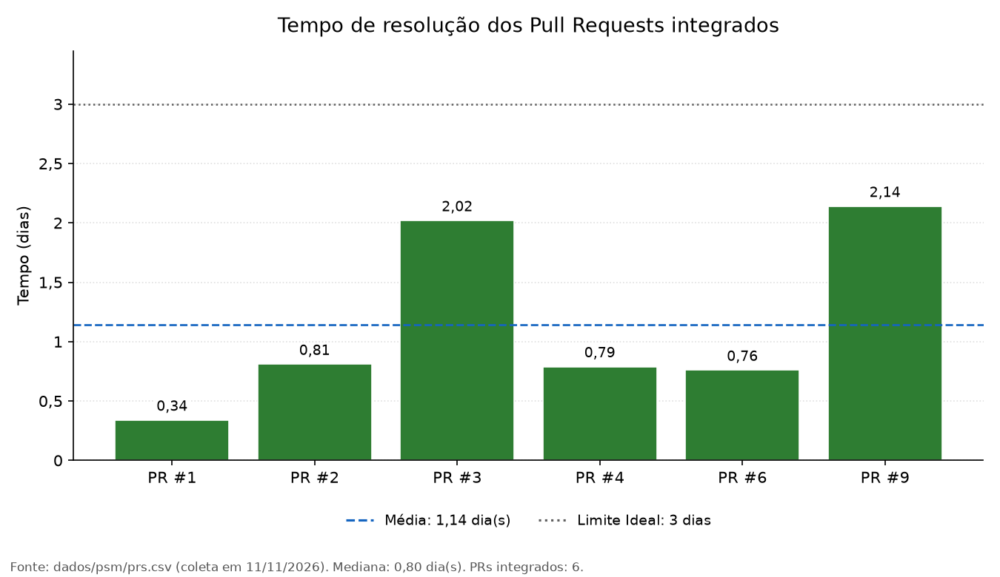

# Métrica 3 - Tempo médio de resolução de Pull Requests: resultados e análise

Esta página apresenta o resultado, o gráfico e a análise da Métrica 3. O método está em [Método](metrica-3-metodo.md).

## 5.5. Resultado

-   Período analisado: 19/10/2026 a 11/11/2026
-   Data da coleta: 11/11/2026 (08:03 UTC)
-   Quantidade de Pull Requests integrados considerados: 6
-   Tempo médio de resolução: 1,14 dia (classificação: **Ideal**)
-   Mediana do tempo de resolução: 0,80 dia
-   Menor tempo de resolução observado: 0,34 dia (PR \#1)
-   Maior tempo de resolução observado: 2,14 dias (PR \#9)
-   Pull Requests fechados sem integração: 0

Cálculo do tempo médio: (0,34 + 0,81 + 2,02 + 0,79 + 0,76 + 2,14) / 6 =
6,86 / 6 ≈ 1,14 dia.

Os tempos individuais de cada Pull Request estão na Figura 3 e, com as
datas completas, no arquivo `dados/psm/prs.csv`.

## 5.6. Visualização dos resultados

*Figura 3: Tempo de resolução dos Pull Requests integrados à `main`
(dias). Fonte: `dados/psm/prs.csv`, gerado por
`scripts/gerar_grafico_prs.py`.*

## 5.7. Análise

O tempo médio de resolução foi de 1,14 dia, dentro do critério Ideal
(até 3 dias). Todos os seis Pull Requests integrados levaram menos de
2,2 dias, e a mediana de 0,80 dia, inferior à média, mostra que a
maioria foi integrada em menos de um dia. A média é puxada pelos PRs
\#3 e \#9, que levaram cerca de 2 dias.

O resultado deve ser lido com cautela: a amostra é pequena (seis Pull
Requests) e o tempo de integração depende da disponibilidade dos
integrantes para revisar, não sendo, isoladamente, medida de
produtividade ou de qualidade.

!!! success "Decisão de gestão decorrente"
    Como o resultado está no critério
    Ideal, o fluxo atual de integração será mantido, e a métrica será
    recalculada na próxima coleta para acompanhar a Entrega 2.
