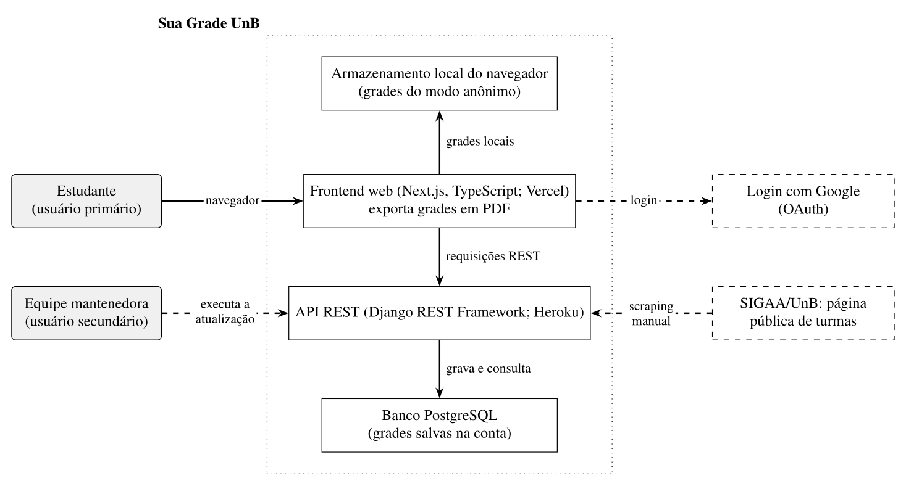
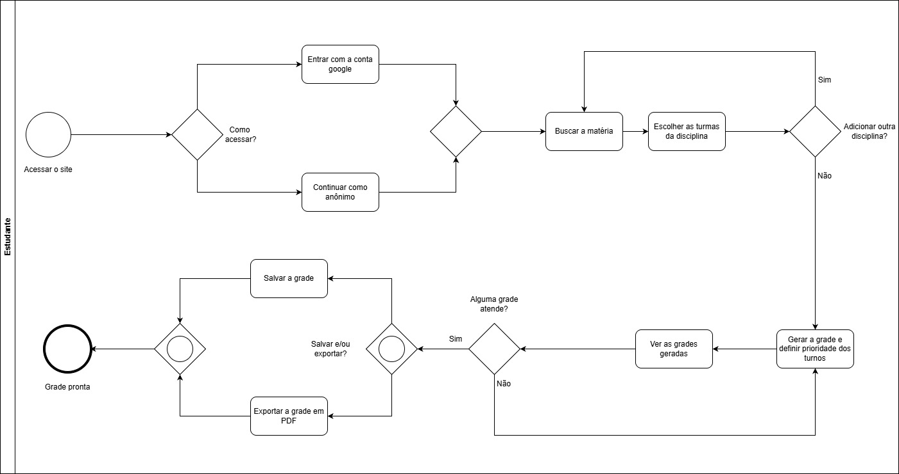
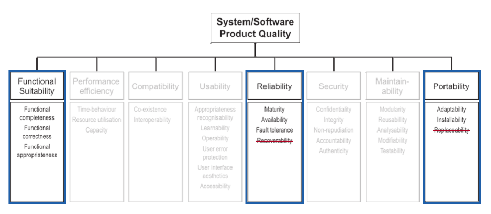

# Sua Grade UnB - Grupo Hedy Lamarr

Repositório acadêmico do grupo **Hedy Lamarr**, desenvolvido para a disciplina **Qualidade de Software** da Universidade de Brasília (UnB), sob orientação da professora Cristiane Soares Ramos. Aqui estão reunidos os documentos, as análises e as evidências produzidos durante a avaliação de qualidade do **Sua Grade UnB**.

> **Escopo deste repositório:** documentação da avaliação de qualidade realizada no contexto da disciplina. Este repositório não é o código-fonte oficial do Sua Grade UnB.

## Sobre o produto avaliado

O [Sua Grade UnB](https://suagradeunb.com.br/) é uma aplicação web que auxilia estudantes da Universidade de Brasília a montar e organizar suas grades de horários, reunindo disciplinas e horários do semestre letivo.

- **Produto avaliado:** [Sua Grade UnB](https://suagradeunb.com.br/)
- **Instituição:** Universidade de Brasília (UnB) - Faculdade UnB Gama (FGA)
- **Disciplina:** Qualidade de Software 1
- **Equipe:** Hedy Lamarr
- **Etapas documentadas:** Fase 1 (Requisitos), Fase 2 (Especificação GQM) e Fase 3 (Plano de Avaliação).

## Estrutura da Documentação

Utilize o menu lateral para navegar pelas fases do processo de avaliação de qualidade (baseado na ISO/IEC 25040 e no GQM):

### Fase 1 - Estabelecer Requisitos de Avaliação
Reúne os documentos de definição do produto, partes interessadas e escopo:
* [2.1 Propósito da Avaliação](fase-1/proposito.md)
* [2.2 Requisitantes e Partes Interessadas](fase-1/requisitantes.md)
* [2.3 Descrição do Produto](fase-1/produto.md)
* [2.4 Justificativas](fase-1/justificativas.md)
* [2.5 Modelo de Qualidade e Escopo](fase-1/modelo.md)
* [2.6 Tabela de Contribuição](fase-1/contribuicao.md)
* [2.7 Declaração de Uso de IA](fase-1/uso-da-ia.md)

### Fase 2 - Especificar a Avaliação (GQM)
Define a hierarquia Goal-Question-Metric, as métricas quantitativas e os critérios de pontuação:
* [Critérios de Julgamento](fase-2/criterios.md)
* [Métricas de Avaliação (M1 a M7)](fase-2/Metricas.md)
* [Objetivos, Questões e Hipóteses](fase-2/objetivos.md)

### Fase 3 - Projetar a Avaliação (Plano Operacional)
Roteiro minucioso para os avaliadores, requisitos de ambiente, massa de dados e cronograma:
* [3.1 Plano de Avaliação de Produto](fase-3/plano-avaliacao.md)

---

## Diagramas e Evidências

### Contexto do produto

### Fluxo de uso

### Modelo de qualidade (SQuaRE)

Para consultar a imagem original do modelo, acesse [modelo-qualidade-iso-original.png](assets/modelo-qualidade-iso-original.png). A metodologia do heatmap de horários da equipe está descrita em [Heatmap de disponibilidade](extras/heatmap.md).

---

## Equipe Hedy Lamarr

| Integrante | Matrícula | Perfil no GitHub |
| :--- | :---: | :--- |
| João Vitor Santos de Oliveira | 221022337 | [@Jauzimm](https://github.com/Jauzimm) |
| Cauã Clemente Oliveira | 222006623 | [@CauaoClemente](https://github.com/CauaoClemente) |
| Pablo Rodrigues Lima | 231029841 | [@Pablo-R-L](https://github.com/Pablo-R-L) |
| Leonardo Rodrigues Martins | 211062105 | [@Antedeguemon21](https://github.com/Antedeguemon21) |
| João Victor Marques Reis de Miranda | 200058576 | [@jmarquees](https://github.com/jmarquees) |

As contribuições detalhadas por atividade estão registradas na [Tabela de Contribuição](fase-1/contribuicao.md).

---

## Histórico de Versões

| Versão | Data | Descrição | Responsável |
| :---: | :---: | :--- | :--- |
| 1.0 | 23/10/2026 | Organização da apresentação do repositório, inclusão de navegação para os documentos da Fase 1, links para diagramas e evidências. | Grupo Hedy Lamarr |
| 1.1 | 26/10/2026 | Inclusão de diagramas GQM e detalhamento das métricas da Fase 2. | Cauã Clemente e Pablo Rodrigues |
| 1.2 | 06/11/2026 | Inclusão do Plano de Avaliação da Fase 3 (métodos, massa de dados e repetibilidade) e atualização da navegação. | Cauã Clemente |

---

*Repositório acadêmico da disciplina Qualidade de Software - Universidade de Brasília (FGA).*
